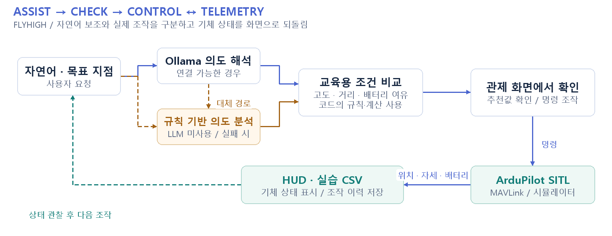

# FLYHIGH Drone GCS

**자연어 의도와 규칙 계산을 결합한 드론 관제 교육 도구**

시뮬레이터 실행부터 연결, 상태 HUD, 목표 이동과 복귀, 실습 기록까지 한 화면 흐름으로 연결했습니다.

2026 | 개인 프로젝트 · 단독 개발 | 프로그램 저작권 등록  
`Python · Tkinter · pymavlink · ArduPilot SITL · Ollama · CSV`

[구성도 SVG 원본](docs/portfolio/architecture.svg)

## 본인 기여

프로그램 기획·화면·MAVLink 통신·실습 안내·AI 보조 기능을 단독 개발했습니다. 실제 기체 대신 SITL을 사용하는 교육 프로그램입니다.

## 기술 구조

| 구성 | 구현 내용 |
|---|---|
| 통신과 상태 표현 | HEARTBEAT, GLOBAL_POSITION_INT, ATTITUDE 등의 MAVLink 메시지를 수신해 모드·고도·GPS·자세·배터리를 HUD에 표시합니다. |
| 자연어와 계산의 분리 | AI Route Assist는 요청 의도를 해석하고 샘플 건물·목표 지점 조건으로 후보 고도를 비교합니다. LLM 연결 실패 시 규칙 기반 의도 분석으로 계속 동작합니다. |
| 교육용 비행 계획 점검 | Battery Safe는 목표 이동과 HOME 복귀 거리를 바탕으로 교육용 여유를 추정합니다. 추천값과 실제 명령 실행을 화면에서 확인하도록 구성했습니다. |
| 동작 이력과 복기 | 시뮬레이터 실행·연결, ARM·이륙·이동·복귀 절차를 안내하고 조작 이벤트와 당시 기체 상태를 CSV로 저장합니다. |

## 구현 결과와 확인 범위

관제 조작·상태 관찰·명령 해설·실습 이력을 묶은 데스크톱 도구를 구현했습니다. 프로그램 저작권 제C-2026-031893호를 등록했습니다.

실제 기체 운용, 최적 경로 보장, 배터리 안전 인증을 검증한 프로젝트가 아닙니다. AUTO 모드 선택과 실제 미션 작성·업로드 기능은 구분합니다.

## 코드와 실행

[전체 프로그램](flyhigh_gcs.py)

ArduPilot SITL 실행 파일과 DLL은 별도로 준비해야 합니다. 준비·실행·명령별 조건은 [기술 문서](README_DETAILS.md)를 참고합니다.

화면·구성도는 설명을 위한 자료이며, 구성도는 현재 코드의 처리 흐름을 정리한 것입니다. 실험 수치와 본인 기여 범위는 위에 명시한 기준으로 해석합니다.
