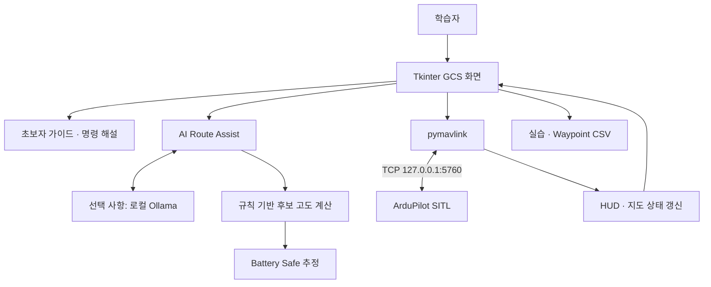

# FLYHIGH Drone GCS

**드론 비행 절차와 MAVLink 명령을 단계별로 학습하는 Python 기반 지상관제 교육 프로그램**

FLYHIGH Drone GCS는 ArduPilot SITL(Software In The Loop) 시뮬레이터와 연결해, 드론의 상태를 관찰하고 비행 명령을 실행하면서 동작 원리를 익히는 데 초점을 둔 데스크톱 응용프로그램입니다. 지도 기반 조작, 명령 해설, 초보자 가이드, 실습 기록을 하나의 화면 흐름으로 연결합니다.

AI Route Assist는 자연어 요청의 의도를 분석한 뒤 규칙 기반 계산으로 목표 고도를 추천합니다. Battery Safe는 목표 이동과 HOME 복귀 거리를 고려해 교육용 배터리 여유를 추정합니다.

> 이 저장소는 응용프로그램 소스와 UI 자산을 공개합니다. 시뮬레이션을 실행하려면 별도의 Windows용 ArduPilot SITL 실행 파일과 DLL이 필요합니다. 실제 기체 운용에 대한 검증 또는 안전 인증을 제공하는 프로젝트는 아닙니다.

## 목차

- [프로젝트 목적](#프로젝트-목적)
- [주요 기능](#주요-기능)
- [시스템 구성](#시스템-구성)
- [AI Route Assist 동작 방식](#ai-route-assist-동작-방식)
- [Battery Safe 동작 방식](#battery-safe-동작-방식)
- [설치 및 실행](#설치-및-실행)
- [실습 시나리오](#실습-시나리오)
- [실습 기록과 파일 구성](#실습-기록과-파일-구성)
- [현재 구현의 범위와 한계](#현재-구현의-범위와-한계)
- [문제 해결](#문제-해결)
- [저작권 및 외부 구성 요소](#저작권-및-외부-구성-요소)

## 프로젝트 목적

드론을 처음 다루는 학습자가 버튼을 누르는 순서뿐 아니라, 명령을 실행하기 위한 조건과 실행 후 상태 변화를 함께 이해하도록 구성했습니다.

- **비행 절차 학습:** 시뮬레이터 실행 → 연결 → GPS 상태 확인 → 모드 선택 → ARM → TAKEOFF → 이동 → 복귀·착륙을 실습합니다.
- **MAVLink 명령 교육:** 화면 조작에 대응하는 명령, 선행 조건, 실행 결과와 실패 원인을 확인합니다.
- **계획 비교:** 목표 좌표와 추천 고도, 배터리 추정값을 비교하면서 이동 계획을 검토합니다.
- **실습 복기:** 조작 이력과 당시 기체 상태를 CSV로 저장해 학습 과정을 돌아봅니다.

## 주요 기능

| 구분 | 구현 내용 |
| --- | --- |
| 시뮬레이터 관리 | ArduCopter 프로세스 실행·종료, 시작 위치 설정, 출력 수집 |
| 통신 | 로컬 TCP MAVLink 연결, HEARTBEAT 및 텔레메트리 수신 |
| 상태 시각화 | 자세, 상대고도, 지상속도, GPS 위성 수, 배터리, ARM 상태, 비행 모드 HUD |
| 비행 명령 | ARM/DISARM, TAKEOFF, 비행 모드 변경, Guided 위치 이동 |
| 지도 | 기체·HOME·목표 위치 표시, 지도 스타일 전환, 실행 경로 표시 |
| 학습 지원 | 단계별 튜토리얼, 현재 실습 단계 안내, 명령 설명, 실패 원인과 조치 안내 |
| AI Route Assist | 자연어 의도 분석, 샘플 건물 기반 후보 고도 비교, 추천 고도 실행 |
| Battery Safe | 목표 이동과 HOME 복귀를 고려한 배터리 소모 추정 및 판정 |
| 기록 | Waypoint 기록, 실습 이벤트 및 기체 상태 CSV 저장 |
| 추가 실습 | 가상 조이스틱을 이용한 RC override |

선택 가능한 비행 모드는 `STABILIZE`, `ALT_HOLD`, `LOITER`, `GUIDED`, `AUTO`, `RTL`, `LAND`입니다. 모드 선택 기능과 AUTO 미션 작성·업로드 기능은 서로 다르며, 이 프로젝트의 Waypoint Log는 조작·목표 지점 기록 기능입니다.

### 화면 조작과 MAVLink의 관계

| 조작 또는 데이터 | 사용 명령·메시지 |
| --- | --- |
| ARM / DISARM | `MAV_CMD_COMPONENT_ARM_DISARM` |
| 이륙 | `MAV_CMD_NAV_TAKEOFF` |
| Guided 목표 좌표·고도 전송 | `SET_POSITION_TARGET_GLOBAL_INT` |
| 가상 조이스틱 | `RC_CHANNELS_OVERRIDE` |
| 위치·상대고도 | `GLOBAL_POSITION_INT` |
| 자세 | `ATTITUDE` |
| 지상속도 | `VFR_HUD` |
| GPS 위성 수 | `GPS_RAW_INT` |
| 배터리·센서 상태 | `SYS_STATUS` |
| 모드·ARM 상태 | `HEARTBEAT` |

위치 목표 전송에는 `MAV_FRAME_GLOBAL_RELATIVE_ALT_INT`를 사용합니다. 입력 고도는 **HOME 기준 상대고도**이며 해발고도나 이동 중 지면과의 실제 간격을 뜻하지 않습니다.

## 시스템 구성



### 사용 기술

| 기술 | 용도 |
| --- | --- |
| Python / Tkinter / ttk | 데스크톱 UI, 대화상자, 이벤트 처리 |
| pymavlink | MAVLink 연결, 명령 송신, 상태 메시지 수신 |
| tkintermapview | 지도와 위치·경로 표시 |
| Pillow | UI 이미지 로딩과 크기 조절 |
| requests | 지명·고도 조회 및 로컬 Ollama HTTP 호출 |
| subprocess / threading | SITL 프로세스 관리와 통신·분석 작업 처리 |
| SQLite / CSV | 지도 캐시 DB 구성 및 실습 데이터 저장 |

### 주요 클래스

| 클래스 | 역할 |
| --- | --- |
| `SITLManager` | 시뮬레이터 프로세스 실행·종료 및 출력 수집 |
| `GCSMap` | 메인 화면, 기체 상태, 명령, 경로 계산과 실습 기록 통합 |
| `GCSHUD` | 자세·고도·속도 등 상태 표시 |
| `AIRouteAssistDialog` | 목표 지점·자연어 요청 입력과 분석 결과 표시 |
| `BatterySafeDialog` | 배터리 추정 옵션 입력과 결과 확인 |
| `BeginnerTutorialDialog` | 단계별 학습 안내 |

현재 구현은 주요 클래스가 하나의 Python 파일에 포함된 구조입니다.

## AI Route Assist 동작 방식

1. 지도, 좌표 또는 주소·장소명 검색으로 목표 지점을 정합니다.
2. 사용자가 원하는 이동 조건을 자연어로 입력합니다.
3. Ollama 사용 시 로컬 모델에 요청을 보내 건물 회피, 배터리 절약, 짧은 이동 등의 의도와 우선순위를 JSON으로 받습니다.
4. Ollama 호출에 실패하면 규칙 기반 의도 분석으로 대체합니다. 규칙 기반 분석을 직접 선택할 수도 있습니다.
5. 시작점과 목표점을 잇는 구간 주변의 **실습용 샘플 건물**을 찾아 높이와 여유 고도를 계산합니다.
6. 여러 후보 고도에 대해 이동 거리, 상승·하강량, 고도 및 조건 미충족 패널티를 비교해 추천값을 선택합니다.
7. 사용자가 실행하면 현재 위치에서 추천 고도에 접근한 뒤 목표 좌표로 이동하는 단계로 진행합니다.

예시 입력:

> 건물 높이를 고려하면서 배터리를 아끼는 고도를 추천해 줘.

LLM은 요청 의도 분석에 사용되고, 후보 고도 계산과 MAVLink 명령 전송은 Python 코드에서 수행합니다. 현재 구현은 여러 수평 우회 경로를 탐색하는 경로 탐색기가 아니라, 목표 지점에 대한 **고도 후보 비교 기능**입니다.

## Battery Safe 동작 방식

현재 배터리와 기체 위치, 목표 지점, HOME 위치, 목표 고도를 이용해 이동 후 예상 잔량을 계산합니다. 목표 고도에는 추가 여유 고도를 적용할 수 있습니다.

```text
예상 소모 = 수평 이동 소모 + 상승 소모 + 하강 소모 + 운용 여유분
예상 잔량 = 현재 배터리 - 예상 소모
수평 이동 거리 = 현재 위치 → 목표 지점 + 목표 지점 → HOME
```

기본 `Training Quad` 프로파일은 다음 계수를 사용합니다.

| 항목 | 기본값 |
| --- | --- |
| 이륙 전 최소 배터리 기준 | 70% |
| 예비 배터리 기준 | 20% |
| 수평 이동 100m당 소모 | 1.20%p |
| 상승 10m당 소모 | 1.60%p |
| 하강 10m당 소모 | 0.45%p |
| 운용 여유분 | 4%p |

이는 교육용 비교 계수이며 측정으로 보정된 실제 기체 성능값이 아닙니다. UI에서 일부 기준을 조정할 수 있습니다.

| 판정 | 조건 |
| --- | --- |
| 이륙 기준 미달 | 현재 고도 0.5m 미만이며 배터리가 최소 이륙 기준 미만 |
| 실행 가능 | 예상 잔량이 예비 배터리보다 10%p 이상 높음 |
| 주의 필요 | 예비 배터리 이상이지만 추가 여유가 10%p 미만 |
| 실행 비추천 | 예상 잔량이 예비 배터리 미만 |

복귀 거리는 추정에 포함되지만, 이 계산이 자동 복귀를 예약하거나 보장하는 것은 아닙니다. 하강 소모 역시 현재 고도와 목표 고도의 차이를 사용하며, 완전한 귀환·착륙 비행 프로파일을 모델링하지 않습니다.

## 설치 및 실행

### 1. 준비 사항

- Windows 데스크톱 환경
- Python 3.x와 Tkinter
- 이 저장소의 Python 파일 및 이미지
- Windows용 ArduPilot SITL의 `ArduCopter.exe`와 필요한 DLL
- 지도 타일, 지명 검색, 고도 조회를 위한 인터넷 연결
- 선택 사항: Ollama 및 사용할 로컬 모델

Python과 라이브러리의 정확한 검증 버전은 현재 배포 자료에 명시되어 있지 않으며, `requirements.txt`의 패키지 버전도 고정되어 있지 않습니다.

### 2. 저장소 받기 및 Python 환경 구성

PowerShell에서 실행합니다.

```powershell
git clone https://github.com/a77315829-byte/flyhigh-drone-gcs.git
cd flyhigh-drone-gcs
python -m venv .venv
.\.venv\Scripts\python.exe -m pip install -r requirements.txt
```

Git을 사용하지 않는 경우 GitHub의 **Code → Download ZIP**으로 받은 뒤 압축을 풀어도 됩니다.

### 3. SITL 파일 배치

보유한 원본 실행 패키지의 `sitl` 폴더를 프로젝트 루트 아래에 배치합니다.

```text
flyhigh-drone-gcs/
├── flyhigh_gcs.py
├── requirements.txt
├── drone.PNG
├── home.PNG
├── target.PNG
├── logo_icon.png
└── sitl/                     # 별도 준비, Git 추적 제외
    ├── ArduCopter.exe
    ├── 필요한 DLL 파일들
    └── 기타 SITL 실행 자료
```

`pip install`만으로 SITL 실행 파일이 설치되지는 않습니다. 소스의 `SITLManager`는 `sitl/ArduCopter.exe`를 직접 실행하도록 작성되어 있어, Linux용 SITL을 설치하는 것만으로 현재 실행 구조를 대체할 수는 없습니다.

### 4. 프로그램 실행

```powershell
.\.venv\Scripts\python.exe flyhigh_gcs.py
```

지도 스타일과 시작 위치를 선택하고 **Start SITL**을 실행합니다. 프로그램은 `tcp:127.0.0.1:5760`으로 연결하고 기체 상태를 수신합니다.

### 5. Ollama 사용 — 선택 사항

Ollama를 설치하고 실행한 환경에서 사용할 모델을 준비합니다. 프로그램의 기본 모델명은 `llama3.2`입니다.

```powershell
ollama run llama3.2
```

AI Route Assist의 모델명 입력란을 준비한 모델과 맞춘 후 **Ollama 분석**을 선택합니다. 코드는 `http://localhost:11434/api/generate`를 호출합니다. 로컬 모델을 사용하지 않을 때에는 **규칙 기반 분석**으로 실습할 수 있습니다.

## 실습 시나리오

### 기본 비행 절차

1. Start SITL로 시뮬레이터를 실행합니다.
2. MAVLink 연결과 GPS 초기화 상태를 확인합니다.
3. 가이드에서 현재 단계와 명령 실행 조건을 읽습니다.
4. GUIDED 모드를 선택하고 ARM을 수행합니다.
5. TAKEOFF 창에서 HOME 기준 상대고도를 입력합니다.
6. HUD에서 ARM 상태, 고도 변화, 배터리와 모드를 확인합니다.
7. 지도에서 목표 지점을 선택하고 Guided 이동을 실행합니다.
8. RTL 또는 LAND 모드의 동작을 실습하고 기체 상태를 확인합니다.
9. 리포트를 저장하고 Exit SITL로 시뮬레이터를 종료합니다.

### AI·배터리 비교 실습

1. 목표 좌표 또는 장소를 설정합니다.
2. 같은 목표에 대해 건물 높이 고려와 배터리 절약 요청을 각각 입력합니다.
3. 후보 고도, 추천값, 계산 근거를 비교합니다.
4. Battery Safe에서 현재 배터리·예비 배터리 기준을 바꾸어 판정 차이를 확인합니다.
5. 실행 전 추천값을 검토하고, 실행 후 HUD와 경로 표시를 관찰합니다.
6. CSV에서 명령 기록과 당시 기체 상태를 비교합니다.

## 실습 기록과 파일 구성

프로그램은 `practice_reports/` 아래에 다음 CSV를 생성합니다.

| 파일 | 주요 내용 |
| --- | --- |
| `practice_report_<session_id>.csv` | 시각, 경과 시간, 조작, MAVLink 명령, 결과, 조건 검사 결과, 모드, ARM 상태, 고도, 속도, GPS, 배터리, 현재·목표 좌표 |
| `waypoint_report_<session_id>.csv` | 순번, 시각, 명령, 목표 좌표·고도, 상태, 입력 출처, 모드, 배터리, 현재 고도 |

CSV는 `utf-8-sig` 인코딩으로 저장합니다. 명령의 `SENT` 또는 `EXECUTED` 기록은 명령 송신·실행 처리 이력이며, 실제 목표 도달을 보장하는 판정은 아닙니다.

| 저장소 파일 | 설명 |
| --- | --- |
| `flyhigh_gcs.py` | 응용프로그램 소스. 최초 공개 시 원본 Python 파일명만 정리 |
| `requirements.txt` | pymavlink, tkintermapview, Pillow, requests |
| `drone.PNG`, `home.PNG`, `target.PNG` | 지도 표시용 UI 이미지 |
| `logo_icon.png` | 프로그램 아이콘 |
| `README.txt` | 원본 프로그램 설명 |
| `.gitignore` | SITL, 로그, CSV, 캐시 DB, 가상환경 등의 Git 추적 제외 설정 |

## 현재 구현의 범위와 한계

- **교육·시뮬레이션 중심:** 실제 기체에 대한 운용 검증 결과나 성능 벤치마크를 포함하지 않습니다.
- **샘플 건물 데이터:** 코드에 정의된 5개 예시 건물을 사용합니다. 실제 건물 DB, 실시간 장애물 인식, 전 지역 장애물 회피 기능은 없습니다.
- **고도 기준:** HOME 기준 상대고도를 사용하므로 지형 변화에 따른 지면 이격거리를 보장하지 않습니다.
- **추천 상한 처리:** 계산한 최소 고도가 입력 최대고도보다 높으면 코드가 내부 최대고도 값을 상향합니다. 입력값을 강제 비행 상한으로 해석해서는 안 됩니다.
- **고도 대기 시간:** AI 이동은 추천 고도 접근을 먼저 시도하지만 약 25초 대기 후에는 목표 좌표 이동 단계로 넘어갈 수 있습니다.
- **배터리 추정:** 바람, 하중, 노후도, 속도 변화 등은 정밀 모델링하지 않습니다. `SAFE`는 프로그램 내부의 교육용 추정 판정입니다.
- **외부 서비스 의존:** 지도는 타일 제공 서비스를 사용하고, 장소 검색에는 Nominatim, 시작 지점 고도 조회에는 Open-Elevation을 사용합니다. 검색어와 조회 좌표는 해당 서비스에 전송됩니다. 고도 조회 실패 시 기본값을 사용합니다.
- **배포 범위:** 외부 실행 파일과 DLL, 생성된 비행 로그, 실습 CSV, 지도 캐시 DB는 저장소에 포함하지 않습니다.

## 문제 해결

| 증상 | 확인 사항 |
| --- | --- |
| `ModuleNotFoundError` | 프로그램을 실행하는 동일한 가상환경에서 `pip install -r requirements.txt`를 수행했는지 확인 |
| Tkinter를 불러오지 못함 | 설치한 Python에 Tcl/Tk 지원이 포함되어 있는지 확인 |
| SITL 경로 오류 | `sitl/ArduCopter.exe` 위치와 필요한 DLL 확인 |
| MAVLink 연결 실패 | SITL이 정상 실행됐는지, TCP 5760 포트에 연결 가능한지, 기존 실행 프로세스가 남아 있는지 확인 |
| ARM 또는 TAKEOFF 제한 | GPS·연결·모드·배터리 상태 및 화면의 명령 해설 확인 |
| 지도·주소 검색 실패 | 네트워크와 외부 서비스 응답 확인. 주소 검색 대신 좌표 입력 사용 가능 |
| Ollama 분석 실패 | 로컬 Ollama 실행 상태와 모델명 확인, 또는 규칙 기반 분석 선택 |
| 이미지 표시 오류 | 이미지가 Python 파일과 같은 폴더에 있는지 확인. 소스는 소문자 `.png` 경로를 사용하며 배포 이미지 일부는 `.PNG`이므로 대소문자 구분 환경에서는 일치시켜야 함 |

## 저작권 및 외부 구성 요소

이 프로젝트는 포트폴리오 및 코드 열람 목적으로 공개합니다. **별도의 오픈소스 라이선스는 부여하지 않습니다.** 법령 또는 GitHub 이용약관에서 허용하는 범위를 제외한 코드의 이용·복제·배포·수정에는 권리자의 별도 허락이 필요합니다. GitHub 서비스 내 열람 및 포크에는 GitHub 이용약관이 적용됩니다.

공개 소스의 설명 범위는 직접 작성한 UI 구성, 실습 흐름, 명령 해설, Waypoint 기록, AI Route Assist 및 Battery Safe 응용 로직입니다. 외부 프로그램·라이브러리·지도 서비스 자체에 대한 권리를 주장하지 않습니다.

ArduPilot SITL, pymavlink, tkintermapview, Pillow, requests, Ollama 등 외부 구성 요소의 권리와 이용·배포 조건은 각 프로젝트에 따릅니다. 원본 프로그램 설명은 [README.txt](README.txt)를 참고하세요.
